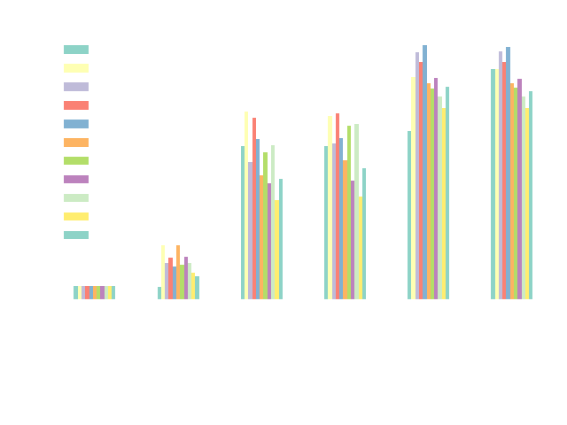

# jax-healpy

**jax-healpy**: A JAX-based implementation of HEALPix functions for high-performance scientific computing.

This project provides a comprehensive JAX-native implementation of HEALPix (Hierarchical Equal Area isoLatitude Pixelization) functions, designed for modern scientific computing with GPU acceleration, automatic differentiation, and seamless integration with machine learning workflows.

[](https://pypi.org/project/jax-healpy/)
[](https://pypi.org/project/jax-healpy/)
[](https://github.com/CMBSciPol/jax-healpy/blob/main/LICENSE)
[](https://github.com/CMBSciPol/jax-healpy/actions/workflows/ci.yml?query=branch%3Amain)
[](https://jax-healpy.readthedocs.io/en/latest/)

## Key Features

- **🚀 GPU Acceleration**: Leverage JAX's XLA compilation for high-performance computing on CPUs and GPUs
- **🔄 Automatic Differentiation**: Full support for forward and reverse-mode automatic differentiation
- **📊 Vectorized Operations**: Efficient batch processing of HEALPix operations
- **🔧 HEALPix Compatibility**: Drop-in replacement for many healpy functions
- **🌐 Spherical Harmonics**: Spherical harmonic transforms computed by ducc0 on CPU and by s2fft on GPU
- **🎯 Clustering Tools**: Advanced clustering algorithms for astronomical data analysis

## Installation

### Prerequisites

First, install JAX following the [official documentation](https://jax.readthedocs.io/en/latest/installation.html) for your target architecture (CPU/GPU).

### Install jax-healpy

Install via PyPI:

```bash
pip install jax-healpy
```

If JAX is not already installed, this command installs its CPU version. JAX and jax-healpy can also be installed together, for instance with NVIDIA CUDA 13 support:

```bash
pip install jax-healpy "jax[cuda13]"
```

The spherical harmonic transforms are computed by an additional library, which depends on the device and is installed by an extra:

```bash
# On CPU: ducc0
pip install "jax-healpy[cpu]"

# On GPU: s2fft, here with NVIDIA CUDA 13 support
pip install "jax-healpy[gpu]" "jax[cuda13]"
```

On a machine with a GPU, install both extras (`"jax-healpy[cpu,gpu]"`) if the transforms are also run without it: on CPU, those of ducc0 are two to three orders of magnitude faster than those of s2fft.

### Development Installation

Clone the repository and set up the development environment with [uv](https://docs.astral.sh/uv/):

```bash
git clone https://github.com/CMBSciPol/jax-healpy.git
cd jax-healpy
uv sync --all-extras
```

## Quick Start

```python
import jax.numpy as jnp
import jax_healpy as hp
import jax

# Create a HEALPix map
nside = 64
npix = hp.nside2npix(nside)

# Convert pixel indices to sky coordinates
pixels = jnp.arange(npix)
theta, phi = hp.pix2ang(nside, pixels)

# Convert sky coordinates back to pixels
recovered_pixels = hp.ang2pix(nside, theta, phi, nest=False)

# Spherical harmonics transform (requires the cpu or the gpu extra)
skymap = jax.random.normal(jax.random.PRNGKey(0), (npix,))
alm = hp.map2alm(skymap, lmax=128)
reconstructed_map = hp.alm2map(alm, nside=nside, lmax=128)
```

## Numerical Precision

jax-healpy follows JAX's precision setting and **does not enable 64-bit precision on import** (since v0.7). By default JAX uses 32-bit.

**We recommend enabling 64-bit precision** for almost all uses. Do it before the first array operation:

```python
import jax

jax.config.update('jax_enable_x64', True)  # process-wide
# or scope it locally:
with jax.enable_x64(True):
    ...
```

32-bit precision matches healpy only at very small `nside`. Even at moderate resolution (e.g. `nside = 256`), float32 rounding shifts points across pixel boundaries, so angle<->pixel conversions and neighbour/interpolation results start to diverge from healpy. Use 32-bit only for small maps or when memory/throughput is the priority and exact healpy agreement is not required.

64-bit is **required** when `nside > 8192`: pixel indices exceed the int32 range, so 32-bit computations overflow and may raise errors, or silently return wrong results. jax-healpy will try to emit a warning in this case.

Pixel-index dtypes track `nside` regardless of the x64 flag: int32 for `nside <= 8192`, int64 above.

## Performance Benchmarks

Execution time measured on high-performance computing systems:

**Test System:**
- CPU: Intel(R) Xeon(R) Gold 2648 @ 2.50GHz
- GPU: NVIDIA Tesla V100-SXM2-16GB



jax-healpy demonstrates significant performance improvements, especially for GPU-accelerated workloads and batch operations.

## Documentation

Complete documentation is available at [jax-healpy.readthedocs.io](https://jax-healpy.readthedocs.io/)

- [Getting Started Guide](https://jax-healpy.readthedocs.io/en/latest/user-guide/getting-started/)
- [API Reference](https://jax-healpy.readthedocs.io/en/latest/api/pixelfunc/)
- [Examples and Tutorials](https://jax-healpy.readthedocs.io/en/latest/user-guide/basic-usage/)

## Development

### Setting up Development Environment

Install development dependencies:

```bash
pip install -e .[test]
```

### Running Tests

Execute the test suite:

```bash
pytest
```

### Code Quality

This project uses pre-commit hooks for code quality:

```bash
pip install pre-commit
pre-commit install
```

## High-Performance Computing

### Environment Setup

For HPC systems, load required modules:

```bash
module load python/3.10
python -m venv venv
source venv/bin/activate
pip install jax-healpy
```

### GPU Support

Ensure JAX is properly configured for your GPU architecture. See the [JAX GPU installation guide](https://jax.readthedocs.io/en/latest/installation.html#gpu) for details.

## Contributing

We welcome contributions! Please see our [Contributing Guide](CONTRIBUTING.md) for details on:

- Setting up the development environment
- Code style and testing requirements
- Submitting pull requests
- Reporting issues

## Citation

If you use jax-healpy in your research, please cite:

```bibtex
@software{jax_healpy,
    author = {Chanial, Pierre and Morshed, Magdy and Biquard, Simon and Kabalan, Wassim and Basyrov, Artem},
    license = {GPL-3.0},
    title = {{jax-healpy: Differentiable implementation of HEALPix functions and extensions in JAX}},
    url = {https://github.com/CMBSciPol/jax-healpy},
    year = {2026}
}
```

## License

This project is licensed under the GNU General Public License v3.0 - see the [LICENSE](LICENSE) file for details.

## Acknowledgments

jax-healpy is developed within the [SciPol](https://scipol.in2p3.fr/) project, funded by the
[European Research Council](https://erc.europa.eu/) (ERC) of the [European Union](https://european-union.europa.eu/),
with the support of the [CNRS](https://www.cnrs.fr/).

- Built on [JAX](https://github.com/google/jax) for high-performance computing
- Compatible with [HEALPix](https://healpix.jpl.nasa.gov/) pixelization scheme
- Integrates with [ducc0](https://pypi.org/project/ducc0/) and [s2fft](https://github.com/astro-informatics/s2fft) for spherical harmonics
- Inspired by the original [healpy](https://github.com/healpy/healpy) package
